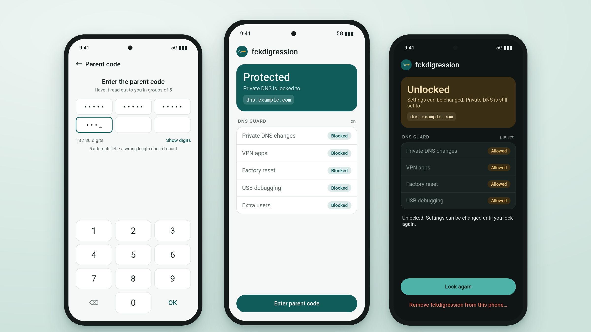
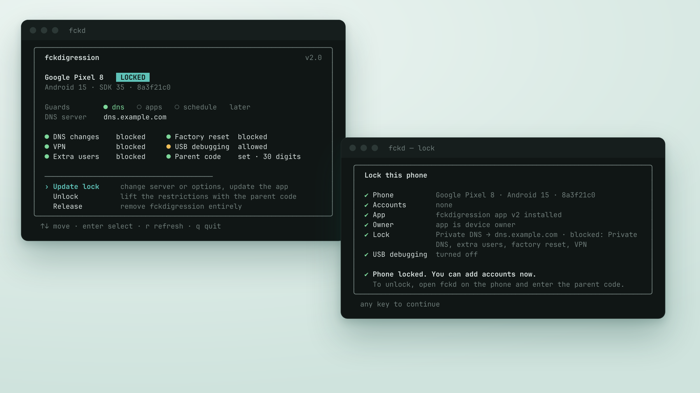

# fckdigression

Locks distractions out of an Android phone. Someone else keeps the code.

`fckd` installs a small app on the phone over USB and makes it the device owner. The app points Private DNS at a filtering server of your choice and blocks the settings that would get around it. Only the parent code lifts the lock.

DNS is the first guard. More will follow (apps, schedules).



## What the DNS guard blocks

- Changing Private DNS
- VPN apps, since a VPN bypasses Private DNS
- Factory reset from Settings
- USB debugging, so adb can't undo the lock
- Adding users or a second space

The server can be any DNS-over-TLS resolver: a public filtering service, a private one, or your own. Android needs it to answer on port 853 with a certificate valid for its hostname.

## Requirements

- An Android 10+ phone with **no accounts** on it. Android only allows a device owner on a phone without accounts. You can add them back once the lock is on.
- A Linux computer with `adb`, Go, a JDK, and the Android SDK (one `build-tools` and one `platforms` folder, found in `$ANDROID_HOME` or `~/Android/Sdk`).

## Install

```sh
make install        # builds the app, then ~/.local/bin/fckd with the app inside
```

## Lock a phone

1. On the phone, turn on Developer options (tap the build number 7 times in Settings → About phone), then USB debugging. Some phones have extra switches, such as "Install via USB".
2. Remove every account from the phone.
3. Connect it and accept the USB debugging prompt.
4. Run:

```sh
fckd lock --dns dns.example.com
```

The person who keeps the code types it when asked (6 digits or more). `--generate-code` makes a random 30-digit code and shows it once instead. The phone only stores a salted SHA-256 of the code.

Running `fckd` with no arguments opens a full-screen interface that does the same.



## Unlock

Open **fckd** on the phone and enter the parent code. From there you can lock again with the same settings, or remove the app.

After 5 wrong codes, each mistake starts a wait: 30 minutes, then doubling up to 24 hours. An entry of the wrong length doesn't count.

If the code is lost, only a factory reset from recovery removes the lock.

## Update the app on a locked phone

Either copy the new APK to the phone and open it (Android accepts it as an update because it has the same signature), or unlock, reconnect and run:

```sh
fckd lock --keep-code
```

The lock, server and code stay as they were.

## Commands

| Command | |
|---|---|
| `fckd` | full-screen interface |
| `fckd lock --dns HOST` | install the app and lock |
| `fckd lock --keep-code` | update the app, keep server and code |
| `fckd status [--json]` | show the lock state |
| `fckd unlock` | lift the lock (needs USB debugging) |
| `fckd release` | lift the lock and uninstall the app |
| `fckd build` | build the APK |

Lock options: `--allow-vpn`, `--allow-reset`, `--allow-debug`, `--generate-code`, `--apk FILE`. Global: `-s SERIAL`, `--no-color`. For scripts, the code can come from `FCKD_CODE`.

## Signing key

The app is signed with `android/dnslock.keystore`, which is not in git. Keep a copy somewhere safe. A phone only accepts updates signed with the same key. Without it, updating means removing the app, which means a factory reset.

For the same reason, the package id stays `fr.lucas.dnslock`.

## More

- [docs/development.md](docs/development.md): project layout, how the PC and the app talk, build notes

## License

[MIT](LICENSE)
